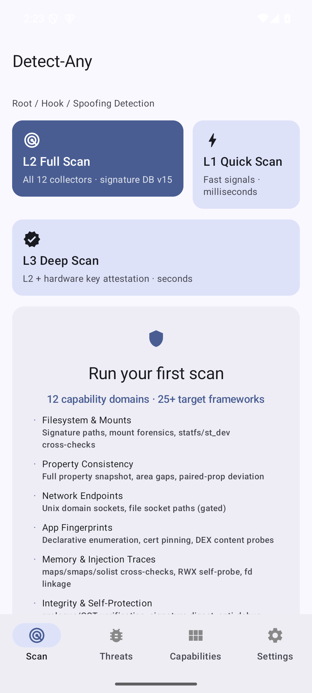
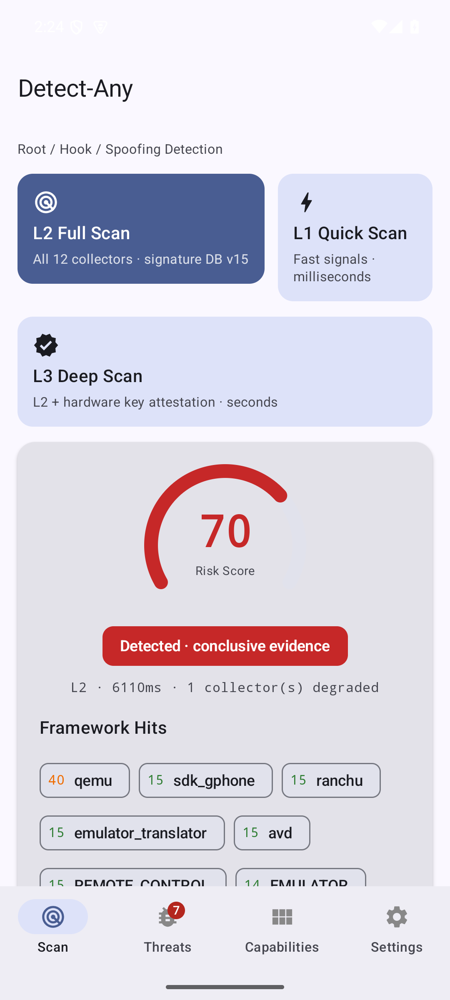
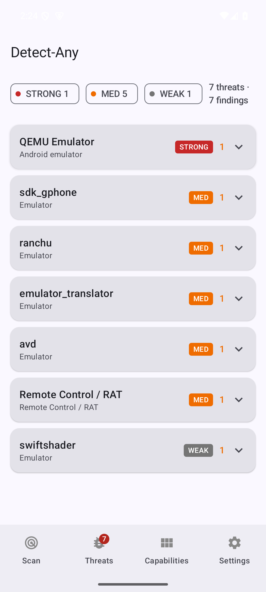
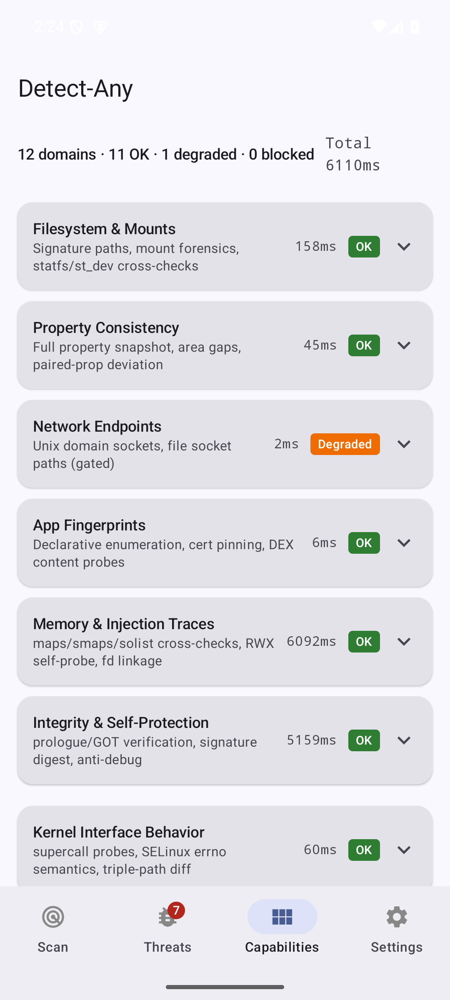
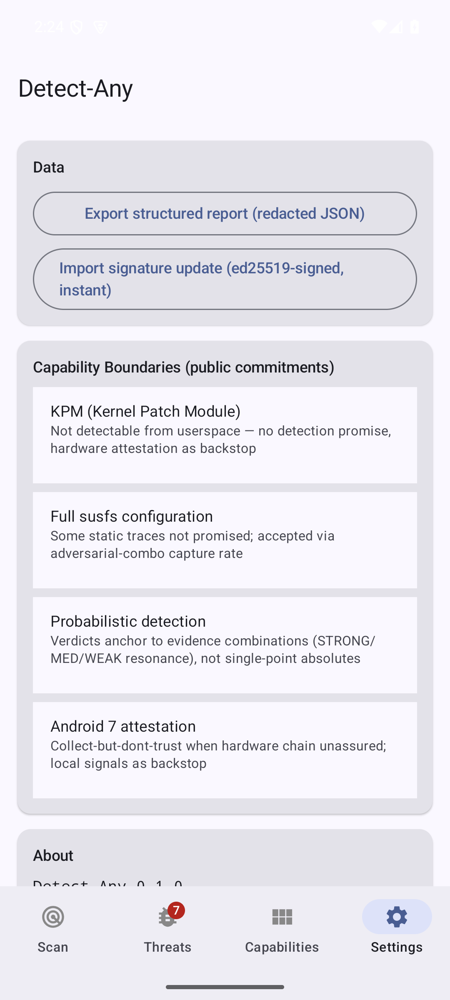

# Detect-Any

**Industrial-grade Android environment integrity detection framework**

[](LICENSE)
[-orange.svg)](app/build.gradle.kts)
[](docs/RUNBOOK.md)
[](#testing)
[](https://github.com/lotty520/Detect-Any/actions/workflows/ci.yml)

---

## Screenshots

| Home | Scan Result | Threats | Capabilities | Settings |
|:---:|:---:|:---:|:---:|:---:|
|  |  |  |  |  |

---

## Overview

Detect-Any scans Android devices for 25+ root frameworks, injection layers, spoofing tools, and risk postures. It produces a single weighted risk score (0-100) with per-item evidence replay, organized into four user-facing views and three scan tiers:

- **L1 Quick** — fast signals only, single-digit milliseconds
- **L2 Full** — all 12 collectors in parallel with evidence vector
- **L3 Deep** — L2 + hardware key attestation (Keymaster chain, CRL, field cross-checks)

Views: **Scan** (risk gauge, verdict badge, delta vs previous scan) · **Threats** (findings grouped by framework with drill-down evidence) · **Capabilities** (12 detection domains with per-probe status and timing) · **Settings** (report export, signature update import).

## Covered Targets

| Category | Frameworks / Tools |
|---|---|
| Kernel Root | KernelSU, KernelSU-Next, SukiSU-Ultra, APatch |
| Userspace Root | Magisk (+ Magisk Delta) |
| Zygisk Injection | ZygiskNext, ReZygisk, NeoZygisk, NyaZygisk |
| Hook Frameworks | LSPosed, Vector, TrustMeAlready |
| Repackaging | LSPatch |
| Attestation Spoofing | TrickyStore, PIF (+ forks) |
| Hiding Stack | susfs (incl. verified-boot contradiction), Shamiko |
| Dynamic Instrumentation | Frida (all variants incl. hluda/Florida, renamed builds) |
| Emulators / VMs | QEMU family, 4-dimension cross (props/hardware/sensors/GL) |
| Cloud Phones | cross-subsystem C-signal resonance (sensor rhythm, battery cross-layer, SIM absence) |
| Device Spoofing | appenv (应用变量), Device ID Changer, VirtualNet, fake GPS/camera tools |
| Risk Postures | VPN/proxy (3 layers), SIM anomalies, geo inconsistency, speed-hack clock drift, screen sharing/recording, overlay injection, automation services |

## Architecture

```
┌────────────────────────────────────────────────┐
│              :app  (Compose UI, 4 tabs)         │
├────────────────────────────────────────────────┤
│        :core:engine (parallel, L1/L2/L3)        │
│   13 collectors → rules → weighted score        │
├────────┬─────────────────┬─────────────────────┤
│ :core  │   :collectors   │      :feature        │
│ rules  │ fs / props      │  attestation (C13)   │
│ model  │ endpoints       │  report / export     │
│ native │ fingerprints    ├─────────────────────┤
│  (JNI) │ memory / integ  │     :selfguard       │
│        │ behavior probes │  anti-debug (async)  │
│        │ virt-env / a11y │  repackaging check   │
│        │ screen-share    │                      │
├────────┴─────────────────┴─────────────────────┤
│ :data:signature (v15, hot-updatable, ed25519)  │
│ :compat:platform (API 24-16 capability gating) │
└────────────────────────────────────────────────┘
```

21 Gradle modules. Every detection flow implements the `Collector` SPI — no special paths, the engine runs all collectors in parallel (total scan time = slowest collector, not the sum).

## Detection Approach

| Signal Class | Grade | Description |
|---|---|---|
| Physical invariants | A | Prologue byte comparison (memory vs disk), triple-path syscall diff, verified-boot contradiction, maps-tamper self-probe — impossible to hide from userspace |
| Behavioral probes | B | Supercall magic numbers (source-audited per framework), D-Bus protocol handshake, sensor rhythm, mount forensics |
| Static traces | C | Signature DB artifacts: paths, sockets, packages, properties, kernel fstypes |

**A** alone triggers a conclusive verdict · **B** requires two hits from independent domains (or cloud-phone C-resonance: ≥3 cross-subsystem signals) · **C** adds weight but never triggers alone.

### Hardware Attestation (L3)

- Dual-root chain validation (RSA 2016 + ECDSA P-384 2026), RKP-only for Android 16 launch devices
- Google's official certificate revocation list consumption (offline snapshot fallback)
- Per-invocation challenge embedding (chain-freshness proof), 3s timeout governance — a slow Keymaster degrades, never blocks
- Field cross-checks: RootOfTrust vs system claims, patch level, StrongBox capability

## Accuracy Discipline

Accuracy is the product's prime directive — false positives destroy trust, false negatives are recoverable:

- **Clean-environment protocol**: every probe change must re-verify on a clean emulator (mandatory, in [AGENTS.md](AGENTS.md))
- **Device matrix**: clean emulator + adversarial Pixel 8 (APatch+susfs deep hiding) + clean mid-range Huawei + cloud-style rooted emulator (TP matrix)
- **Honest boundary docs**: unreachable/unwired/dormant entries are labeled, never over-promised ([DETECTION_ACCURACY.md](docs/DETECTION_ACCURACY.md) grades all 142 items by evidence chain)
- Historical FP fixes (OEM prop pairs, emulator artifacts, timing side-channel) are documented as lessons in [AGENTS.md](AGENTS.md)

## Comparison with Open-Source Alternatives

Measured against the leading open-source detection libraries (Nov 2026):

| | Detect-Any | [RootBeer](https://github.com/scottyab/rootbeer) ⭐3.0k | [Ruru](https://github.com/byxiaorun/Ruru) ⭐841 | [android-rasp](https://github.com/securevale/android-rasp) ⭐155 | [Free-RASP](https://github.com/talsec/Free-RASP-Android) ⭐279 |
|---|---|---|---|---|---|
| Detection items | **142 (evidence-graded)** | ~15 | focused (hidden manager) | ~20 | closed-core |
| Native layer (C/C++) | **1,400 lines** (svc guard, ELF parser, probes) | none | partial | none | closed |
| Physical-invariant A-grade signals | **prologue bytes, syscall diff, verified-boot contradiction** | — | — | — | — |
| Deep hiding (susfs + manager uninstalled) | **yes (adversarial-device verified)** | no (acknowledged) | partial | no | unknown |
| Hardware attestation | **L3 tier (chain, CRL, cross-checks)** | — | — | — | — |
| Hot-updatable signature DB | **ed25519-signed, versioned** | — | — | — | — |
| 16KB page-size | **build-enforced gate** | n/a | n/a | n/a | n/a |
| Behavioral contracts | **10 specs, 31+ requirements** | — | — | — | — |
| Honest per-item accuracy docs | **142-item evidence ledger** | — | — | — | — |
| License | Apache-2.0 | Apache-2.0 | Apache-2.0 | Apache-2.0 | **non-commercial free tier, closed core** |

Notes: RootBeer remains the most widely adopted; Free-RASP's repository hosts a demo app only — the detection core ships as a closed-source binary from a private Maven repository. Detection-Any focuses on auditability: every claim is traceable to a test, device log, or source-audited constant.

## Verified Against

| Environment | Result |
|---|---|
| Clean emulator (API 35) | 70/7 baseline, zero FPs across 17 audit rounds |
| Pixel 8 adversarial (APatch + susfs deep hiding) | 68 conclusive, 8/8 true positives |
| Cloud-style rooted emulator TP matrix | Frida 3×B / scrcpy dual-A / 6 path families all hit |
| Clean mid-range Huawei (Kirin 710F, API 31, no GMS) | 26 not-conclusive; one OEM prop FP caught & fixed by this very device |
| Pixel 4 unlocked (real Google TEE) | L2 18 clean; **L3 hardware attestation Trusted** — first real-TEE trusted verdict via expired-2016-root policy path |
| Redmi Note 9 (MIUI 12, automation tool installed) | All findings true positives incl. randomized-package automation tool; MIUI property landscape zero FP |

ADB semantics note: `adb_session` is a **C-grade device-posture factor** (2026-11-12 revision) — ADB state alone never contributes to a remote-control verdict; direct session verdicts come from A-grade socket/HID probes.

## Requirements

| | |
|---|---|
| minSdk | 24 (Android 7.0) |
| ABIs | arm64-v8a, armeabi-v7a |
| Page size | 16KB aligned (build-enforced gate) |
| Native size | ~613KB stripped |

## Build

```bash
git clone https://github.com/lotty520/Detect-Any.git
cd Detect-Any
./gradlew assembleDebug
```

**Prerequisites**: JDK 17+, Android SDK (API 35), NDK 25.2+, CMake 3.22+

## Testing

```bash
./gradlew test                              # host unit tests (115)
./gradlew :app:connectedDebugAndroidTest    # device tests (21 per device)
./gradlew :app:verify16kAlignment           # 16KB alignment gate
./gradlew :app:lintDebug                    # NewApi = 0 enforced
```

## Performance

| Metric | Pixel 8 (flagship) | Huawei mid-range (Kirin 710F) |
|---|---|---|
| Quick scan (L1) | 9-13ms | 0-1ms |
| Full scan (L2) | ~969ms (dual-manager adversarial setup) | 722-887ms |
| Deep scan (L3) | L2 + ~3.7s attestation | pending device retest |

## Project Structure

```
Detect-Any/
├── app/                     # Compose UI + navigation (4 tabs, L1/L2/L3 tiers)
├── core/
│   ├── model/               # Collector SPI, Finding, Confidence grades
│   ├── engine/              # Parallel orchestration, score model, tiers
│   ├── rules/               # Rule engine (single-attribution matching)
│   └── native-platform/     # JNI: raw svc executor, ELF parser, probes
├── collectors/              # 13 probe modules (one per detection domain)
├── feature/
│   ├── attestation/         # Hardware key attestation (C13, L3 tier)
│   └── report/              # Report presenter, exporter, update import
├── data/signature/          # Hot-updatable signature DB (v15, ed25519-signed)
├── compat/platform/         # API 24-16 capability gating
├── selfguard/               # Self-protection (async anti-debug, integrity)
├── docs/                    # Engineering documentation
└── openspec/                # 10 behavior-contract specs (31+ requirements)
```

## Documentation

| Doc | |
|---|---|
| [Contributing](CONTRIBUTING.md) | How to add detection items without breaking accuracy |
| [Detection Catalog](docs/DETECTION_CATALOG.md) | All 90+ detection items (signature DB v15 + behavioral probes) |
| [Detection Accuracy](docs/DETECTION_ACCURACY.md) | Per-item evidence grading (TP/FP verified, blind spots, boundaries) |
| [Framework Interfaces](docs/FRAMEWORK_INTERFACES.md) | Source-audited stable interface constants (supercall magics etc.) |
| [Threat Model](docs/CHEATING_THREAT_MODEL.md) | 80+ tools across 12 domains, incl. BTMOB RAT intel |
| [Coverage Analysis](docs/COVERAGE_ANALYSIS.md) | 3-layer × 6-dimension coverage matrix |
| [Capability Boundaries](docs/CAPABILITY_BOUNDARIES.md) | What is explicitly not promised |
| [Regression Matrix](docs/REGRESSION.md) | Device test data, timing benchmarks, fix chains |
| [Runbook](docs/RUNBOOK.md) | Build, ops, hot-update, release checklist |

## Known Limitations

- Kernel Patch Modules (KPM) are not detectable from userspace
- Cloud phones passing through real peripherals require server-side correlation (virtual-peripherals form is detectable via C-resonance)
- RAT families with randomized packages (BTMOB class) hit a package-visibility wall — accessibility/overlay signals only
- Modern Android (API 28+) restricts `/proc/net` reading: multi-port D-Bus enumeration falls back to the default port, unix-socket probing is gated
- Deep hiding that wipes all property residue leaves behavioral signals only

## License

Apache License 2.0 — see [LICENSE](LICENSE)

## Acknowledgments

- Community research: [Chunqiu Detector](https://github.com/mingzun09/Chunqiu-Detector-Problem-solution), [vvb2060/MagiskDetector](https://github.com/vvb2060/MagiskDetector)
- [OWASP MASTG](https://mas.owasp.org/MASTG/) resilience methodology baseline
