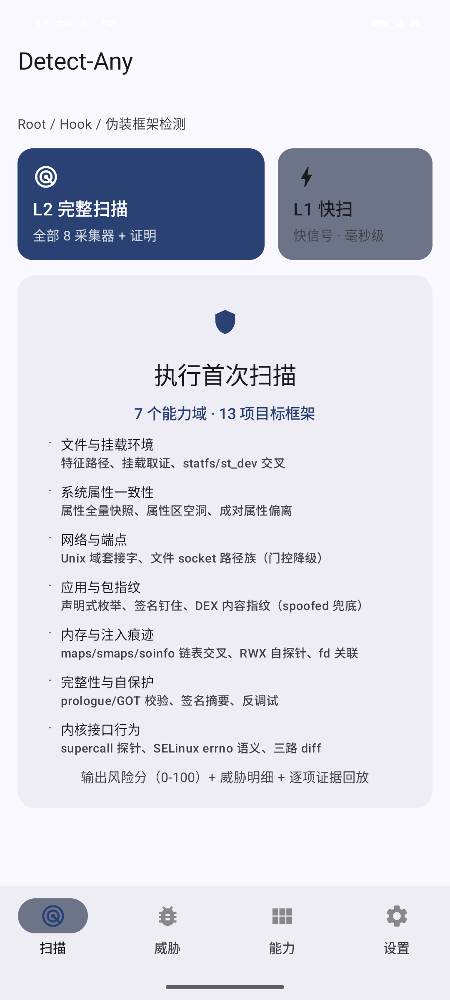
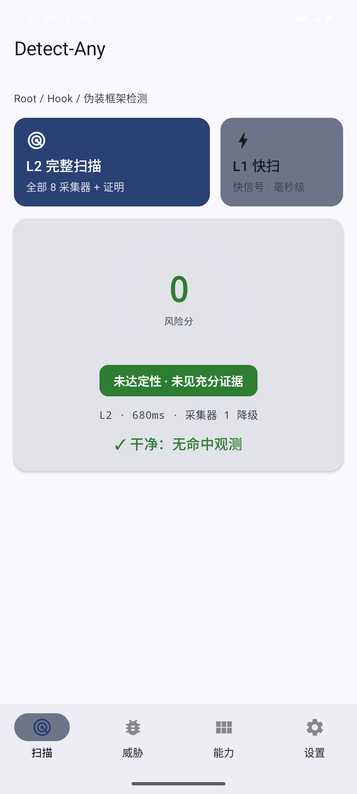
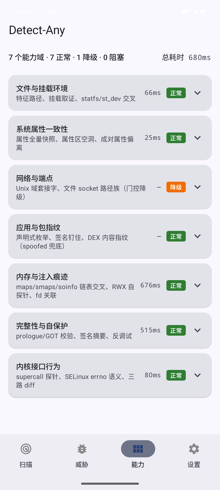

# Detect-Any

**Industrial-grade Android environment integrity detection framework**

[](LICENSE)
[-orange.svg)](app/build.gradle.kts)
[](docs/RUNBOOK.md)
[](#testing)

---

## Screenshots

| Home | Scan Result | Capabilities | Settings |
|:---:|:---:|:---:|:---:|
|  |  |  |  |

---

## Overview

Detect-Any scans Android devices for 19 root frameworks, injection layers, and attestation spoofing tools. It produces a single weighted risk score (0-100) with per-item evidence replay, organized into four user-facing views:

- **Scan** — risk gauge, verdict badge, threat chips, delta vs previous scan
- **Threats** — findings grouped by detected framework with drill-down evidence
- **Capabilities** — 7 detection capability domains with per-probe status and timing
- **Settings** — report export, signature update import, capability boundaries

## Covered Targets

| Category | Frameworks |
|---|---|
| Kernel Root | KernelSU, KernelSU-Next, SukiSU-Ultra, APatch |
| Userspace Root | Magisk |
| Zygisk Injection | ZygiskNext, ReZygisk, NeoZygisk, NyaZygisk |
| Hook Frameworks | LSPosed, Vector, TrustMeAlready |
| Repackaging | LSPatch |
| Attestation Spoofing | TrickyStore, PIF |
| Hiding Stack | susfs, Shamiko |
| Detection Tools | ZygiskDetect |

## Architecture

```
┌─────────────────────────────────────────────┐
│              :app  (Compose UI)              │
├─────────────────────────────────────────────┤
│           :core:engine (parallel)            │
│    collectors → rules → weighted score       │
├────────┬────────────┬──────────────────────┤
│ :core  │ :collectors│     :feature          │
│ rules  │ filesystem │  attestation          │
│ model  │ properties │  report / export      │
│ native │ endpoints  ├──────────────────────┤
│ (JNI)  │ fingerprints│    :selfguard        │
│        │ memory     │  anti-debug           │
│        │ integrity  │  integrity check      │
│        │ behavior   │                       │
├────────┴────────────┴──────────────────────┤
│ :data:signature  │  :compat:platform        │
│ (hot-updatable)  │  (API 24-16 gating)      │
└──────────────────┴─────────────────────────┘
```

## Detection Approach

The engine combines multiple independent signal types into a weighted score:

| Signal Class | Grade | Description |
|---|---|---|
| Physical invariants | A | Cross-layer consistency checks that are physically impossible to hide from userspace |
| Behavioral probes | B | Active probes that detect framework-specific responses |
| Static traces | C | Filesystem paths, socket names, package identifiers |

**Grade A** signals alone can trigger a conclusive verdict. **Grade B** requires two hits from independent domains. **Grade C** contributes weight but never triggers alone.

### Hardware Attestation

- Dual-root chain validation (RSA 2016 + ECDSA P-384 2026)
- RKP-only enforcement for Android 16 launch devices
- Google's official certificate revocation list consumption
- Anti-relay via application ID binding

## Requirements

| | |
|---|---|
| minSdk | 24 (Android 7.0) |
| ABIs | arm64-v8a, armeabi-v7a |
| Page size | 16KB aligned |
| Native size | ~613KB stripped |

## Build

```bash
git clone https://github.com/lotty520/Detect-Any.git
cd Detect-Any
./gradlew assembleDebug
```

**Prerequisites**: JDK 17+, Android SDK (API 35), NDK 25.2+, CMake 3.22+

## Testing

```bash
# Host unit tests (153)
./gradlew test

# Device tests (42 per device)
./gradlew :app:connectedDebugAndroidTest

# 16KB alignment gate
./gradlew :app:verify16kAlignment
```

## Performance

| Metric | Value (Pixel 8) |
|---|---|
| Full scan (L2) | 847ms |
| Quick scan (L1) | ~10ms |

## Project Structure

```
Detect-Any/
├── app/                    # Compose UI + navigation
├── core/                   # Engine, rules, model, JNI bridge
├── collectors/             # Detection probe implementations
├── feature/                # Attestation, report/export
├── data/signature/         # Hot-updatable signature database
├── compat/platform/        # API level gating
├── selfguard/              # Self-protection
├── docs/                   # Documentation
└── openspec/               # Behavior contracts
```

## Documentation

| Doc | |
|---|---|
| [Detection Catalog](docs/DETECTION_CATALOG.md) | All 58 detection items |
| [Capability Boundaries](docs/CAPABILITY_BOUNDARIES.md) | What is explicitly not promised |
| [Regression Matrix](docs/REGRESSION.md) | Device test data |
| [Runbook](docs/RUNBOOK.md) | Build, ops, release checklist |

## Known Limitations

- Kernel Patch Modules (KPM) are not detectable from userspace
- Full susfs configuration may partially conceal static traces
- ptrace residue detection is being neutralized by newer Zygisk implementations

## License

Apache License 2.0 — see [LICENSE](LICENSE)

## Acknowledgments

- Community research: [Chunqiu Detector](https://github.com/mingzun09/Chunqiu-Detector-Problem-solution), [vvb2060/MagiskDetector](https://github.com/vvb2060/MagiskDetector)
- [OWASP MASTG](https://mas.owasp.org/MASTG/) resilience methodology baseline
