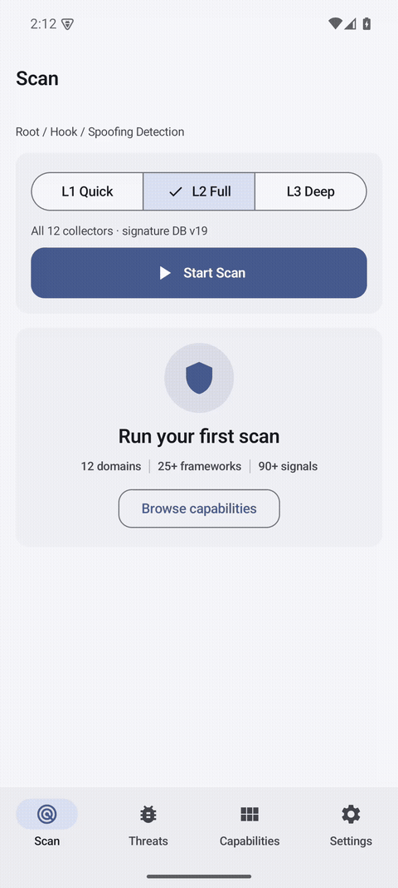

# Detect-Any

**Industrial-grade Android environment integrity detection — open source, evidence-graded, false-positive disciplined.**

Android 7.0+ · no root required · scan runs fully offline · Apache-2.0

---

## What it does

Detect-Any scans a device for **25+ root frameworks, injection layers, spoofing tools, and risk postures** — 145 detection items, each graded by evidence strength, producing a weighted 0-100 risk score with per-item evidence replay.

Three tiers: **L1 Quick** (single-digit milliseconds) · **L2 Full** (12 collectors in parallel, scan time = slowest collector) · **L3 Deep** (+ hardware key attestation: dual-root chain, CRL, field cross-checks).

## Why it's different

| | Detect-Any | typical detectors |
|---|---|---|
| Evidence grading | **A** physical invariants (prologue bytes, triple-path syscall diff, verified-boot contradiction — single hit conclusive) | string/path lists |
| Deep hiding (susfs + manager uninstalled) | **penetrates** (adversarial-device verified) | usually blind |
| scrcpy `--new-display` invisible remote control | **detected** (display classification + composite-B, real-device E2E verified) | not covered |
| False positives | **documented forensically** — every FP incident public (a clean Huawei scored 58, a clean Xiaomi 98 — both root-caused) | undisclosed |
| Honest boundaries | per-item accuracy ledger, capability boundaries doc | over-promising |

## Accuracy is the product

> False negatives are recoverable; false positives destroy trust.

Every probe change must pass a clean-emulator protocol **and** a multi-vendor real-device FP certification before commit. Every A/B-grade signal must answer: *why can this not physically occur on a legitimate device?* Read the [Accuracy Discipline](accuracy.md) page, or start with the forensic story of the two flagship false positives: [Why a Clean Huawei Scored 58, and a Clean Xiaomi 98](essay-oem-fp-forensics.md).

## Try the adversarial side

Running a hiding stack (susfs, Shamiko, TrickyStore, hidden managers)? The [Deep-Hiding Challenge](challenge.md) wants your L2 result — catches and misses both make the tool better.

## Links

- **Source**: [github.com/lotty520/Detect-Any](https://github.com/lotty520/Detect-Any)
- **APK**: [releases/latest](https://github.com/lotty520/Detect-Any/releases/latest) (SHA-256 published per release)
- **Deep docs (中文, source of truth)**: [detection catalog](https://github.com/lotty520/Detect-Any/blob/main/docs/DETECTION_CATALOG.md) · [coverage matrix](https://github.com/lotty520/Detect-Any/blob/main/docs/COVERAGE_ANALYSIS.md) · [FP certification](https://github.com/lotty520/Detect-Any/blob/main/docs/FP_CERTIFICATION.md) · [capability boundaries](https://github.com/lotty520/Detect-Any/blob/main/docs/CAPABILITY_BOUNDARIES.md)
